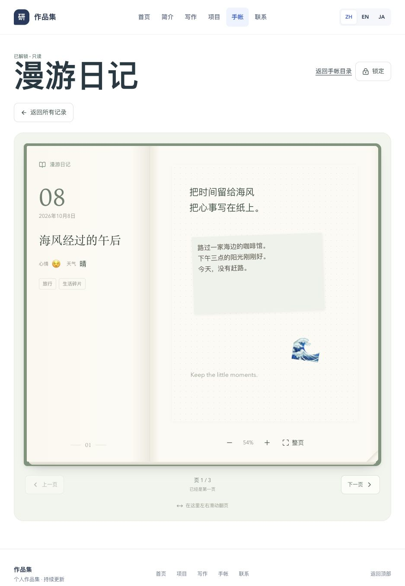

# 手帐书页翻阅发布报告

发布时间：2026-10-08 22:06（Asia/Shanghai）

发布版本：`portfolio-journal-book-20261008-220224-cea21ecd`

## 功能

前台解锁后，点击“翻阅手帐”或打开一条记录即可进入书页阅读器。桌面显示摊开的双页，左页展示日期、标题、心情、天气和标签，右页保留原有画布。手机显示单页，包含纸张、书脊阴影、页叠和翻页动画。

支持上一页／下一页、聚焦阅读器后的方向键、底部独立滑动区；画布继续独立拖动和缩放。加载和翻页期间禁止重复导航，读取失败保留当前页，减少动态效果偏好会直接切换页面。后台选择一本手帐后也可直接翻阅，并通过“编辑这一页”回到编辑器。

锁定、会话过期、前台会话验证和换本会立即隐藏阅读器及旧页动画层。修复了迟到的初始会话响应重新解锁，以及重叠会话检查提前显示内容的竞态。

## 修改范围

- 新增 `JournalBookReader.tsx`、对应 CSS 和组件测试。
- 接入前台及后台手帐阅读入口，增加本地化文案和访问时序测试。
- 画布增加书页展示样式；画布保存、全屏编辑、5 MB 图片限制保持生效。
- 本次仅更新前端，Go 服务文件、数据库结构和访问权限规则保持原样。

与上次线上源码快照比较，共 10 个源码／说明文件新增或修改，详情见 `release-metadata.json`。冻结源码构建结果与工作区构建一致，发布包及全部前端产物均完成 SHA-256 校验。

## 验证

- 完整前端测试：27 个测试文件，299 项通过。
- 组件测试覆盖边界页、加载／动画期间禁用、旧页隔离与清理、减少动画、方向键及滑动误触过滤。
- 页面测试覆盖读取失败、返回列表／锁定／换本时迟到响应、前台验证移除新旧页和会话竞态。
- 修改范围 ESLint、TypeScript 编译和生产构建通过。
- 独立本地数据库样例的真实浏览器验证：桌面双页、390px 与 320px 单页、前后翻页动画、方向键、画布缩放、锁定即时隐藏；窄屏无横向溢出。
- 公网目录、查看密码页面和健康接口正常；浏览器没有控制台错误。
- 公网入口 JS/CSS 与本次产物 SHA-256 一致；运行容器内全部 128 个前端文件校验通过。

## 运行状态

- `portfolio-app` 容器：`02a309094438ace02b864936b6589aab8e68aa03c8aeef42b188504e939ed584`
- 镜像：`sha256:cef8ffeb8187eb76957ef5fb093e464674b38d566420fe578365003b224f17df`
- 服务文件 SHA-256：`9185e4640e5d5fe8dde36713e3efe5c4c7deb117f623dfa4407732e6ffc219fa`，与切换前一致。
- healthy，重启计数 0，启动日志正常。
- `.env`、Compose、Caddy、端口、挂载、网络及远端未提交改动均保留。
- Flowspace 前后端未重建，仍为 healthy，重启计数 0。

## 备份与回滚

发布前已保存 PostgreSQL custom-format 完整备份，并通过 `pg_restore --list` 验证；原运行配置和 Compose 备份为 0600 权限。发布目录：

`/home/ubuntu/apps/self/runtime/releases/portfolio-journal-book-20261008-220224-cea21ecd`

如需回滚，仅恢复旧镜像并重建应用：

```bash
cd /home/ubuntu/apps/self
docker tag self-portfolio-app:rollback-portfolio-journal-book-20261008-220224-cea21ecd self-portfolio-app
docker compose up -d --no-build --no-deps --force-recreate --wait --wait-timeout 120 portfolio-app
```

本次没有数据库迁移，常规回滚无需恢复数据库。

## 书页示例

截图使用独立本地测试数据。


