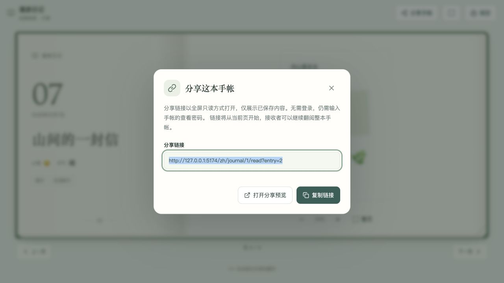
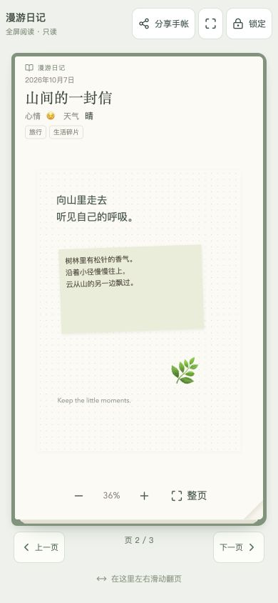

# 手帐全屏只读分享发布报告

发布时间：2026-10-08 22:35（Asia/Shanghai）

发布版本：`portfolio-journal-share-20261008-223127-0ce90fc6`

## 功能

后台选择手帐本、打开已保存记录，或在已解锁的前台阅读时，点击“分享手帐”即可生成链接，复制或在新标签打开预览。分享整本默认从第一页开始；分享当前记录使用 `?entry=记录ID` 定位起始页，接收者仍可翻阅整本手帐。

分享地址为 `/:locale/journal/:notebookId/read`，以独立全屏只读页面打开，没有网站导航、后台入口、编辑、保存或上传工具。桌面双页、手机单页，翻页按钮和独立滑动区域保持可见，仍可缩放画布；提供浏览器全屏按钮。矮屏允许滚动以保证操作可达。

分享仅展示已保存内容。管理端只允许分享已开启前台展示、已设置密码且未归档的本子；未保存的新记录不显示分享入口。编辑中的草稿不会进入链接，未保存的本子移动也不会改变已保存记录的分享归属。

## 访问保护

链接不包含密码、会话或授权 token，不增加任何查看权限。分享页始终使用现有公开 API 与附件地址，管理员打开分享页同样经过查看密码验证。关闭前台展示、归档或更换密码沿用原有访问撤销规则。

锁定、到期、前台验证和 URL 变化会隐藏当前书页及动画副本。起始页不存在、已删除或不属于当前本子时显示缺页提示，不自动打开其他记录。被前台验证取消的首请求会在最新有效会话检查成功后重新加载，旧请求不能覆盖新 URL 或重新显示已锁定内容。

服务端原有手帐路径策略覆盖分享路线：`Cache-Control: private, no-store`、`X-Robots-Tag: noindex, nofollow`；客户端继续使用通用公开本名和密码提示作为元信息。

## 验证

- 完整前端测试：30 个文件、353 项全部通过。
- 新增分享组件、管理端和分享页测试，覆盖链接不携带秘密、复制失败回退、公开资格、草稿边界、非法／跨本／删除页、锁定／过期／切换 URL 晚到请求，以及前台检查与轮询重叠的恢复竞态。
- 修改范围 ESLint、TypeScript 和生产构建通过；冻结源码构建与工作区产物 SHA-256 一致。
- 本地独立数据库真实浏览器验证：指定页直达、复制成功、弹窗焦点、全屏入口／退出、桌面与 390px／320px 手机布局、翻页、缩放、锁定即时清除。320px 窄屏无横向溢出，翻页按钮位于视口内。
- 线上直接刷新 `/zh/journal/2/read` 正常展示独立查看密码页，没有网站导航或编辑工具；公网健康接口正常。
- 公网 JS/CSS 与发布产物哈希一致，运行镜像内全部 128 个前端文件校验通过。

## 发布范围与状态

与上次线上快照比较，18 个源码／说明／测试文件新增或修改，见 `release-metadata.json`。仅更新前端，Go 服务、数据库结构、密码规则、5 MB 图片上传限制及部署配置保留。

- 容器：`31dd44efa00219a4966b9a66c4f552f7ef4e1fd5f4b4f847b0f209f399fac87e`
- 镜像：`sha256:f3cc55150e5705e38afb53bdfcf492430b55abe716756d4d24410157c0be1fe4`
- Go 服务 SHA-256：`9185e4640e5d5fe8dde36713e3efe5c4c7deb117f623dfa4407732e6ffc219fa`，切换前后相同。
- healthy、重启计数 0，启动日志正常。
- `.env`、Compose、Caddy、端口、挂载、网络及远端未提交工作区保留。
- Flowspace 前后端未重建，均为 healthy，重启计数 0。

## 备份与回滚

发布前完整 PostgreSQL custom-format 备份已通过 `pg_restore --list` 验证，运行配置和 Compose 备份权限为 0600。发布目录：

`/home/ubuntu/apps/self/runtime/releases/portfolio-journal-share-20261008-223127-0ce90fc6`

回滚仅恢复旧镜像并重建应用：

```bash
cd /home/ubuntu/apps/self
docker tag self-portfolio-app:rollback-portfolio-journal-share-20261008-223127-0ce90fc6 self-portfolio-app
docker compose up -d --no-build --no-deps --force-recreate --wait --wait-timeout 120 portfolio-app
```

本次没有数据库迁移，常规回滚无需恢复数据库。

## 示例

以下截图使用独立本地测试内容。




