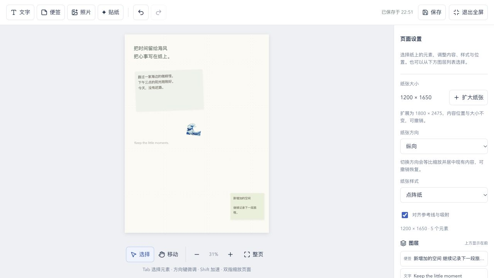
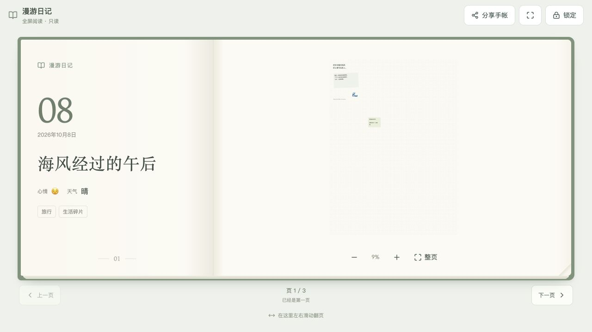

# 手帐纸张空间扩展发布报告

发布时间：2026-10-08 22:56（Asia/Shanghai）

发布版本：`portfolio-journal-space-20261008-225006-e4e0d8bb`

## 功能

手帐编辑器的纸张设置新增“扩大纸张”。每次宽高增加 50%，标准 800 × 1080 纸张可扩展为 1200 × 1620；接近上限时按比例扩至最大边 4000。只在右侧和底部增加空白空间，文字、照片、便签与贴纸的坐标、尺寸、旋转、样式、锁定及资产引用保持原样。

扩展通过现有编辑提交流程，支持撤销、重做和自动保存。旧记录保留已保存尺寸，不自动迁移；只读分享页没有扩展控制。尺寸变化后自动适应整页，编辑与阅读最低缩放为 2%，手机可以完整展示最大纸张。

## 验证

- 完整前端测试：30 个文件、368 项全部通过。新增扩展边界、元素引用与内容保持、保存回显后撤销重做、禁用与只读限制、窄视口整页、大纸张 PNG／PDF 导出验证。
- 修改范围 ESLint、TypeScript 与生产构建通过；冻结源码构建与工作区产物 SHA-256 一致。
- 独立本地 PostgreSQL 和示例手帐实测：800 × 1100 扩至 1200 × 1650 后所有已有元素样式和坐标不变；自动保存成功，撤销重做有效；在原纸张之外的 (880, 1320) 新增便签并保存成功。
- 最大 2909 × 4000 示例纸张在 320 × 640 手机编辑器及全屏分享页完整适应，无横向溢出；分享页无编辑控制，不同尺寸书页可翻阅。
- 线上 `/zh/journal/2/read` 仍展示查看密码页；公网健康检查正常，JS/CSS 哈希与发布产物一致，运行镜像内全部 128 个前端文件校验通过。

## 发布范围与状态

7 个源码／说明／测试文件修改，详见 `release-metadata.json`。仅更新前端；Go 服务 SHA-256、数据库结构、密码与访问规则、5 MB 图片限制保留。线上手帐内容未改动。

- 容器：`1aaee435a63b9cd21c824d09fbc9dc258b501cdfe240f79923b71d2848833560`
- 镜像：`sha256:8cdccc601bd6e6cea83c3e37e2cf2619145a66905b1e3c7807a5cdd429d44122`
- Go 服务 SHA-256：`9185e4640e5d5fe8dde36713e3efe5c4c7deb117f623dfa4407732e6ffc219fa`
- healthy，重启计数 0，启动日志正常。
- `.env`、Compose、Caddy、端口、挂载、网络及远端未提交工作区保留。
- Flowspace 前后端容器保持原样且健康。

## 备份与回滚

发布前完整 PostgreSQL custom-format 备份已通过 `pg_restore --list` 验证，运行配置备份权限为 0600。发布快照目录：

`/home/ubuntu/apps/self/runtime/releases/portfolio-journal-space-20261008-225006-e4e0d8bb`

回滚命令：

```bash
cd /home/ubuntu/apps/self
docker tag self-portfolio-app:rollback-portfolio-journal-space-20261008-225006-e4e0d8bb self-portfolio-app
docker compose up -d --no-build --no-deps --force-recreate --wait --wait-timeout 120 portfolio-app
```

本次无数据库迁移，回滚无需恢复数据库。

## 示例

以下截图仅使用独立本地示例内容。




