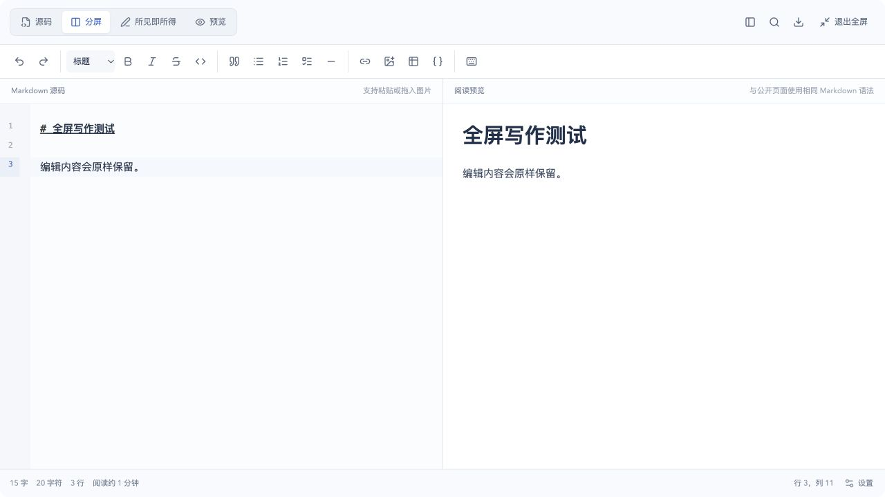

# Markdown 编辑区扩展与全屏写作发布报告

发布时间：2026-10-13 00:40（Asia/Shanghai）

发布版本：`portfolio-markdown-fullscreen-20261013-003611-442a472d`

## 功能

后台 Markdown 编辑区在桌面端改为随视口自适应的 600–820px 高写作空间，普通窗口即可显示更多正文和预览内容。小屏继续使用原有自适应规则，避免固定最小高度撑开页面。

工具栏原有全屏入口改为始终显示文字的“全屏写作”按钮，全屏模式调整为铺满整个浏览器窗口，并保留源码、所见即所得、预览、目录、查找替换和导出等原有能力。切换时复用同一个编辑器节点，正文、选区和撤销历史不会重建。按 Esc 可以退出，页面滚动随即恢复，键盘焦点回到“全屏写作”按钮。

## 验证

- 完整前端测试：30 个文件、368 项全部通过；包含全屏 portal、滚动锁、Esc 退出和焦点恢复验证。
- 修改范围 ESLint、TypeScript 与生产构建通过；冻结源码构建与工作区产物 SHA-256 一致。
- 1280 × 720 桌面实测：普通编辑区为 924 × 600，“全屏写作”按钮文字完整可见；全屏对话框为 1280 × 720，无横向溢出，正文和预览内容保留。
- 390 × 844 手机实测：全屏对话框完整覆盖视口，无横向溢出，“退出全屏”始终可访问，正文内容保留。
- 线上 `/admin/login`、静态资源和 `/api/health` 正常；运行镜像内 128 个前端文件与发布产物哈希一致。

浏览器测量数据见 [browser-verification.json](browser-verification.json)。

## 发布范围与状态

本次源码范围为 Markdown 编辑器组件、样式、测试和 README，仅更新前端静态资源。线上手帐、文章和其他业务内容均未修改；Go 服务文件、数据库结构、权限逻辑和运行配置保持不变。

- 容器：`806e1c3946bb65d4c53f51cff9d3bb8848ec5d638ea2f8fbe253202db568fc35`
- 镜像：`sha256:1bb852b42ba4dce8005bb2ea7b06998e3459fbe80e029ebc03117d9c47394aa5`
- Go 服务 SHA-256：`9185e4640e5d5fe8dde36713e3efe5c4c7deb117f623dfa4407732e6ffc219fa`
- healthy，重启计数 0，启动日志正常。
- `.env`、Compose、Caddy、端口、挂载、网络和远端 checkout 保持不变。
- Flowspace 前后端容器保持原样且健康。

## 备份与回滚

发布前 PostgreSQL custom-format 完整备份已通过 `pg_restore --list` 验证。发布快照目录：

`/home/ubuntu/apps/self/runtime/releases/portfolio-markdown-fullscreen-20261013-003611-442a472d`

回滚命令：

```bash
cd /home/ubuntu/apps/self
docker tag self-portfolio-app:rollback-portfolio-markdown-fullscreen-20261013-003611-442a472d self-portfolio-app
docker compose up -d --no-build --no-deps --force-recreate --wait --wait-timeout 120 portfolio-app
```

本次无数据库迁移，回滚无需恢复数据库。

## 示例

以下截图使用独立本地示例内容。





